# ¿Qué hay en la foto?

Tomas una foto con el teléfono, la subes, y en un par de segundos la aplicación te dice qué ve en ella, con un porcentaje al lado de cada cosa. La foto queda guardada en un bucket de Cloud Storage y aparece en una galería con las últimas fotos del grupo. Quien reconoce lo que hay en la imagen no es código tuyo: es Cloud Vision, un modelo que Google ya entrenó y que se usa con una petición HTTP.

La plantilla trae las dos aplicaciones completas y la infraestructura del frontend y el backend. Tu grupo construye en Terraform el bucket, el permiso del backend sobre él y el acceso a Vision.

| Sin bucket todavía | Con etiquetas | La galería |
|---|---|---|
| 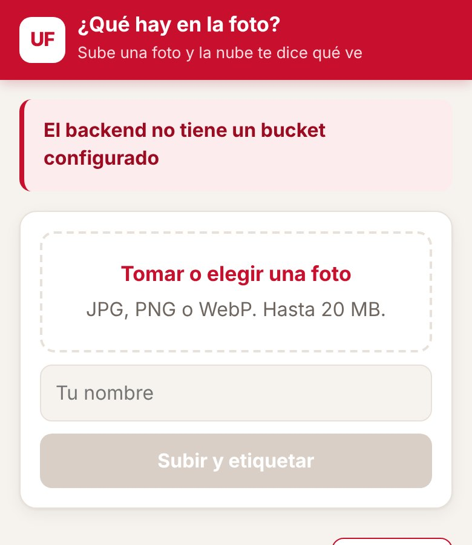 | 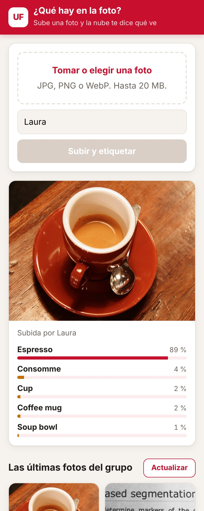 | 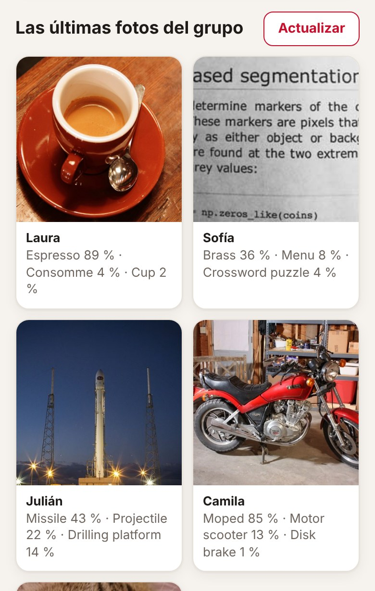 |

Las capturas salen de una prueba local: Cloud Storage simulado y, en lugar de Vision, un modelo de clasificación pequeño corriendo en el computador. Por eso las etiquetas de las capturas no son las de Vision; las reales las vas a ver cuando lo despliegues.

## Arquitectura al terminar la práctica

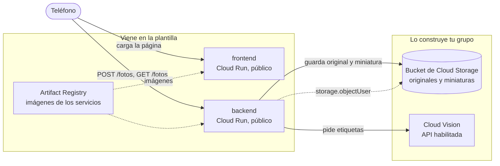

La flecha punteada es el único permiso de IAM que da tu grupo: la cuenta del backend puede crear, leer y listar objetos en ese bucket y en ningún otro. Para llamar a Vision no hace falta ningún rol: basta con que la API esté habilitada en el proyecto y con que el backend corra con una cuenta de servicio del mismo proyecto.

En la plantilla, la variable `BUCKET` del backend está vacía: responde que no tiene dónde guardar y no guarda nada. Es lo primero que vas a ver al desplegar.

## Estructura del repositorio

```
backend/main.py            API en Flask: recibe la foto, hace la miniatura, pide etiquetas y guarda en el bucket
backend/requirements.txt   Dependencias del backend con versión fija
backend/Dockerfile         Imagen del backend con gunicorn
frontend/index.html        La página: subir una foto, ver sus etiquetas y la galería del grupo
frontend/server.py         Servidor sin dependencias que inyecta BACKEND_URL en la página
frontend/Dockerfile        Imagen del frontend
infra/providers.tf         Versión de Terraform y del proveedor de Google
infra/variables.tf         Proyecto, prefijo, región e imágenes
infra/main.tf              APIs, registro, backend y frontend con sus cuentas
infra/outputs.tf           Ruta del registro y URL de los servicios
infra/terraform.tfvars.example   Ejemplo de valores; cópialo como terraform.tfvars
docs/api.md                Endpoints del backend y cómo se guardan las fotos
docs/capturas/             Capturas de la aplicación usadas en este README
.gitignore                 Deja por fuera el estado de Terraform, tus tfvars y __pycache__
```

## Cómo empezar

### Flujo de trabajo

1. Crea el repositorio de tu grupo con **Use this template** en GitHub.
2. Edita en VS Code o en github.dev (tecla `.` en la página del repositorio).
3. Haz commit y push desde el editor.
4. En Cloud Shell clonas la primera vez y traes los cambios con `git pull` después. Desde Cloud Shell nunca haces push.
5. Docker y Terraform se ejecutan siempre en Cloud Shell. La consola de Google Cloud es para mirar y diagnosticar, no para crear recursos.

### Primer despliegue

En Cloud Shell:

```bash
git clone https://github.com/<tu-usuario>/<tu-repositorio>.git
cd <tu-repositorio>/infra
cp terraform.tfvars.example terraform.tfvars
cloudshell edit terraform.tfvars
```

En `terraform.tfvars` pon el ID de tu proyecto y el prefijo del grupo, y ajusta las rutas de las imágenes a esos mismos valores. Este archivo vive solo en Cloud Shell: el `.gitignore` evita que llegue a GitHub.

El orden importa, porque las imágenes necesitan el registro y los servicios necesitan las imágenes:

```bash
# 1. Solo el registro (y las APIs de las que depende)
terraform init
terraform apply -target=google_artifact_registry_repository.registro

# 2. Las imágenes
REGISTRO=$(terraform output -raw registro)
gcloud auth configure-docker us-central1-docker.pkg.dev --quiet
cd ..
docker build -t $REGISTRO/backend:v1 backend
docker push $REGISTRO/backend:v1
docker build -t $REGISTRO/frontend:v1 frontend
docker push $REGISTRO/frontend:v1

# 3. Todo lo demás
cd infra
terraform apply
terraform output
```

Abre `url_frontend` en el teléfono. Si usas otra región, cambia `us-central1` en el comando de `gcloud auth configure-docker`, y ten en cuenta que la cuota gratuita de Cloud Storage solo aplica en `us-central1`, `us-east1` y `us-west1`.

Cuando cambies el código de un servicio, construye y sube la imagen con una etiqueta nueva (`v2`, `v3`...), actualízala en `terraform.tfvars` y vuelve a aplicar. Si subes otra vez la misma etiqueta, Terraform no ve ningún cambio y Cloud Run sigue con la versión anterior.

## Probar cada servicio con `docker run`

Antes de subir una imagen, pruébala en Cloud Shell. Para ver una página servida en Cloud Shell usa **Vista previa en la Web** y elige el puerto.

**Frontend.** No necesita credenciales:

```bash
docker run --rm -p 8080:8080 -e BACKEND_URL=https://<url-del-backend> $REGISTRO/frontend:v1
```

Abre la vista previa en el puerto 8080. Si no pasas `BACKEND_URL`, la página va a decir que no pudo hablar con el backend.

**Backend sin bucket.** El contenedor arranca aunque no tenga credenciales, y sin la variable `BUCKET` responde con un error claro:

```bash
docker run --rm -d --name backend -p 8081:8080 $REGISTRO/backend:v1
curl -i localhost:8081/fotos
docker logs backend
docker rm -f backend
```

Debe responder `503` con el error en JSON y una advertencia en los registros.

**Backend con bucket.** Cuando el bucket ya existe y la API de Vision está habilitada, puedes darle al contenedor tus propias credenciales:

```bash
gcloud auth application-default login
docker run --rm -d --name backend -p 8081:8080 \
  -e GOOGLE_CLOUD_PROJECT=<tu-proyecto> \
  -e BUCKET=<nombre-del-bucket> \
  -e GOOGLE_APPLICATION_CREDENTIALS=/adc.json \
  -v $HOME/.config/gcloud/application_default_credentials.json:/adc.json:ro \
  $REGISTRO/backend:v1
curl -X POST localhost:8081/fotos -F "autor=Ana" -F "foto=@una-foto.jpg"
curl localhost:8081/fotos
```

Los detalles de cada endpoint están en [docs/api.md](docs/api.md).

---

# Informe del grupo

## Integrantes

| Integrante | Código |
|---|---|
| Michell Mahecha | 1152407 |
| Cristian Zambrano | 1152408 |
| Scharid Maldonado | 1152418 |

## URL de la aplicación

Frontend: https://practica6-frontend-osxnccwgoq-uc.a.run.app

Backend: https://practica6-backend-osxnccwgoq-uc.a.run.app

## Diagrama propio

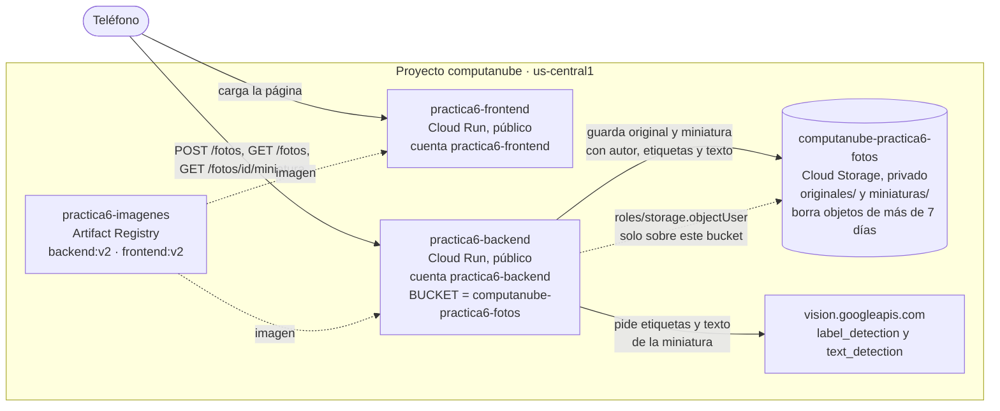

La única flecha de IAM que creamos es la del backend sobre el bucket (`google_storage_bucket_iam_member.backend_objetos`). Vision no necesita rol: basta con que la API esté habilitada en el proyecto y que el backend use una cuenta de servicio del mismo proyecto.

## Evidencias por fase

## Fase 0. Preparación

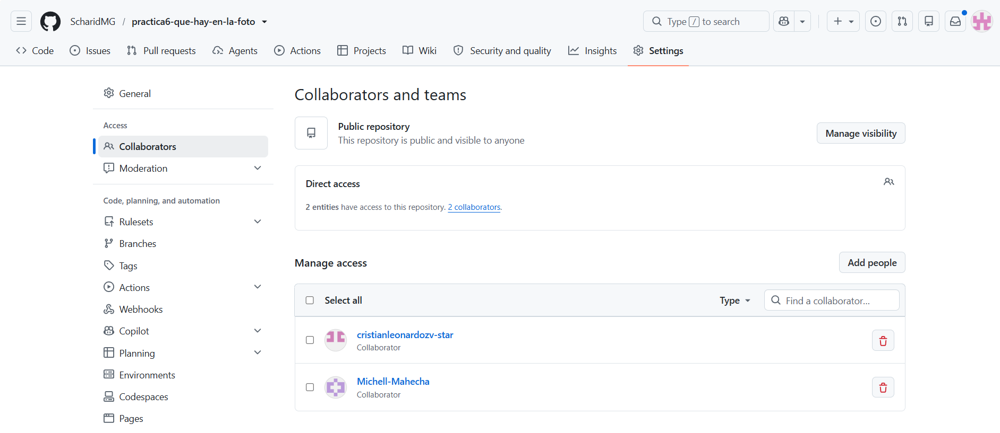

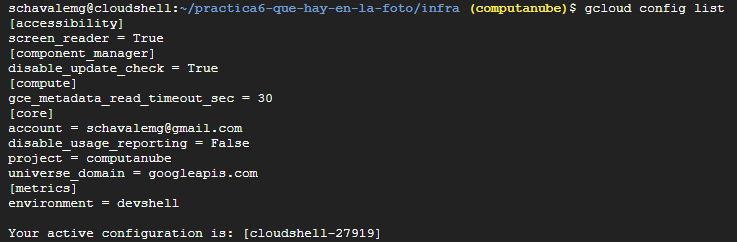

## Fase 1. Registro, imágenes y el primer despliegue

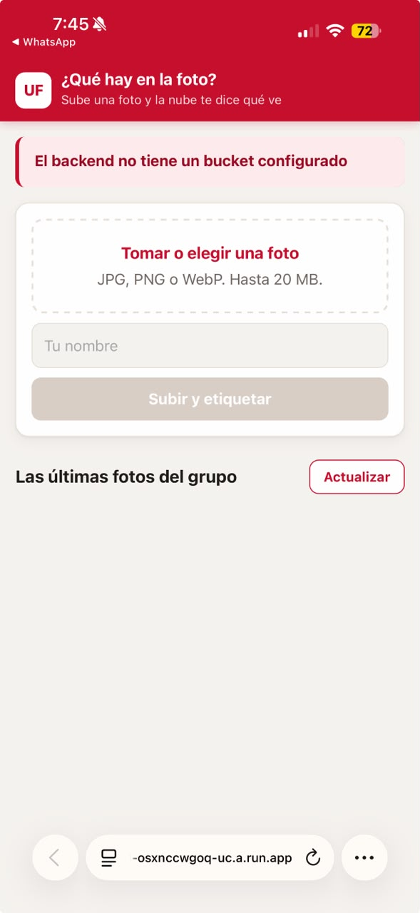

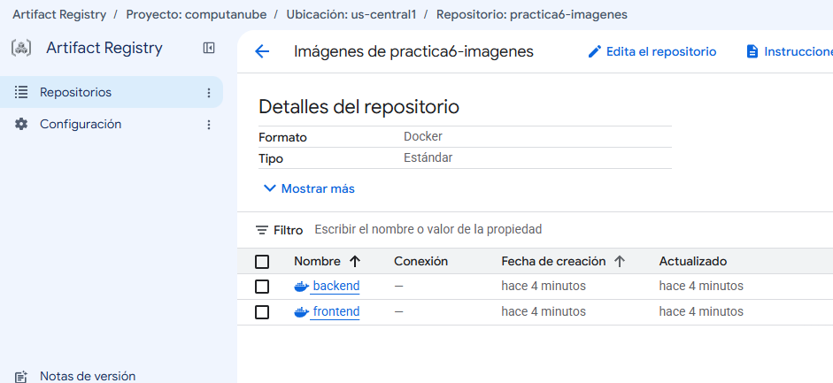

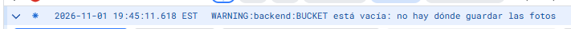

## Fase 2. El bucket

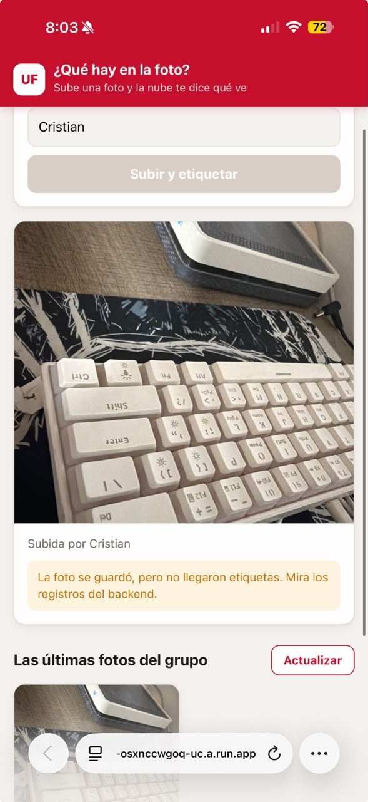

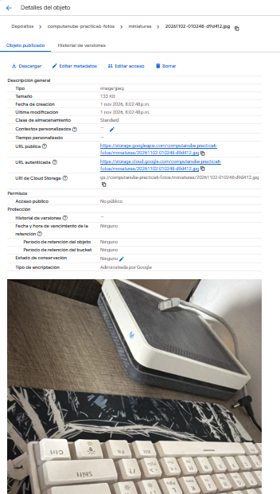

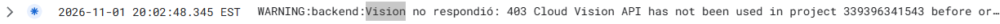

## Fase 3. Vision

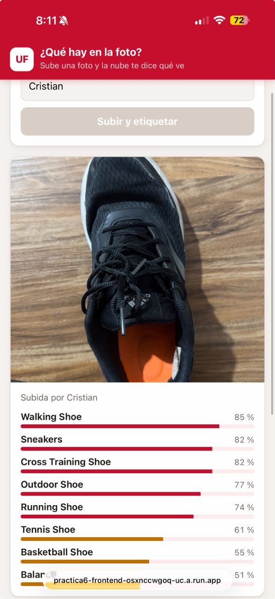


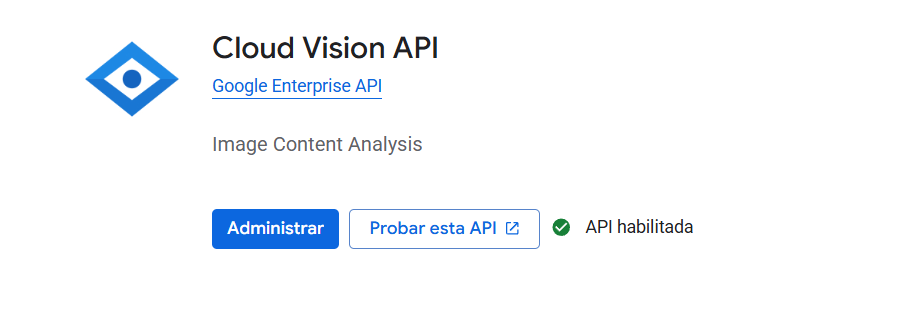

## Fase 4 – Ponerlo a prueba

| # | Foto | Quién | Etiqueta 1 | Etiqueta 2 | Etiqueta 3 | ¿Acertó? ¿Qué le faltó? |
|---|---|---|---|---|---|---|
| 1 | Zapato (común, bien iluminado) | Cristian | Walking Shoe 85 % | Sneakers 82 % | Cross Training Shoe 82 % | Acertó, y hasta el tipo de zapato. Es un objeto muy común en internet. |
| 2 | Bandera de Colombia (típico de la región) | Cristian | Orange 92 % | Screenshot 50 % | — | Falló: no reconoció la bandera. Solo vio un color y que era una captura de pantalla. Solo dio dos etiquetas. Lo local lo reconoce peor que lo común. |
| 3 | Dibujo a mano | Michell | Paper 85 % | Paper Product 83 % | Office supplies 71 % | Falló: vio la hoja, pero no lo que estaba dibujado. Etiquetó el material en vez del contenido. |
| 4 | Página con texto | Scharid | Paper 87 % | Number 85 % | Paper Product 77 % | A medias: supo que era papel con números, pero no leyó lo que dice. Leer texto es otra función (`text_detection`), que es parte del reto. |
| 5 | Zapato movido | Michell | Silver 74 % | Walking Shoe 72 % | Foot 66 % | A medias: todavía reconoce el zapato, pero la primera etiqueta pasó a ser un color, y la confianza del zapato bajó de 85 % a 72 %. |

Conclusión: Vision acierta con objetos comunes y bien iluminados, pero falla con lo local (la bandera), con los dibujos (ve el papel, no lo dibujado) y con el texto (sabe que hay números, pero no los lee). Cuando la foto está movida, baja la confianza y aparecen etiquetas vagas como colores.

## Fase 5. Mirar el bucket

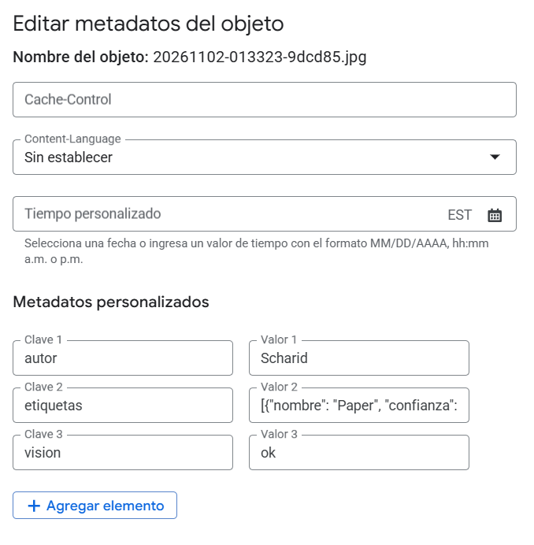

Con `gcloud storage ls -l` se ven los 11 originales y sus 11 miniaturas:

| | Original | Miniatura |
|---|---|---|
| Foto `20261102-013323-9dcd85` | 3.112.748 bytes (≈ 3,1 MB) | 159.199 bytes (≈ 159 KB) |
| Promedio de 11 fotos | 2.640.354 bytes (≈ 2,6 MB) | 110.039 bytes (≈ 110 KB) |
| Total | 29.043.894 bytes (27,70 MiB) | 1.210.433 bytes (1,15 MiB) |

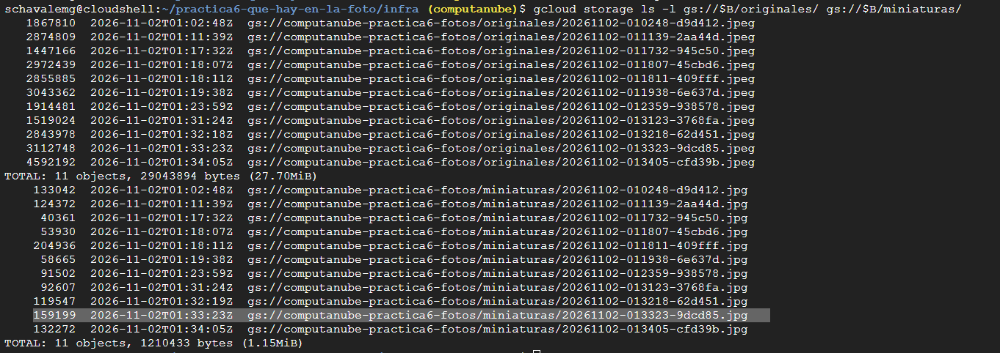

La miniatura pesa unas 24 veces menos que el original. Como la salida de datos de Cloud Run hacia Colombia cuesta USD 0,19 por GiB, el backend solo sirve miniaturas: cada vista de la galería cuesta 24 veces menos que si sirviera los originales. Además, las "carpetas" `originales/` y `miniaturas/` no existen: son parte del nombre de cada objeto.

## Fase 6. Reto de la semana: leer, limpiar y contar

1. leer el texto con Vision

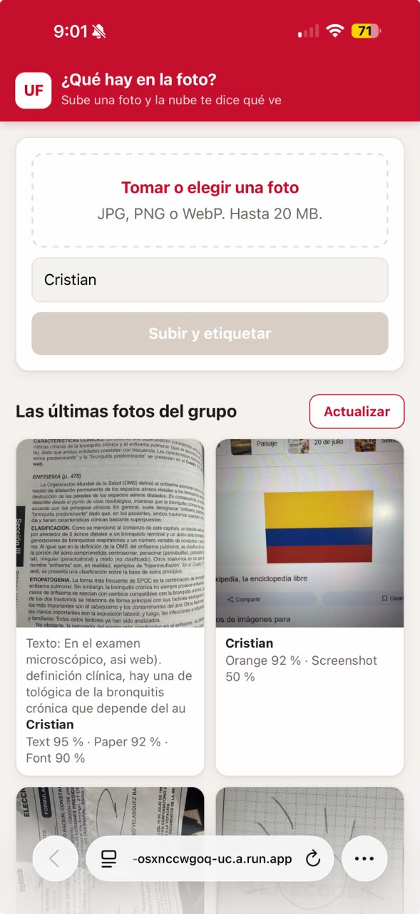

2. Limpieza automática.

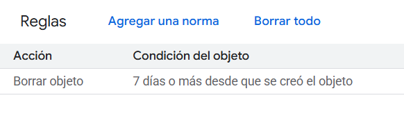

3. La cuenta de la cuota gratuita

Datos reales de nuestro bucket (11 fotos): original promedio 2.640.354 bytes (≈ 2,6 MB) y miniatura promedio 110.039 bytes (≈ 110 KB). Cuota gratuita mensual tomada de la tabla "Lo que cuesta" de la guía.

Supuestos por foto, según el código: Vision usa 2 unidades (`label_detection` + `text_detection`); Cloud Storage hace 3 operaciones de clase A (subir original, subir miniatura y listar la galería, que el frontend recarga después de cada subida).

| Recurso | Cuota gratis al mes | Gasto por foto | Fotos al mes |
|---|---|---|---|
| Vision | 1.000 unidades | 2 unidades | **500** |
| Operaciones de clase A | 5.000 | 3 | ≈ 1.666 |
| Espacio | 5 GB | ≈ 2,75 MB durante 7 días (regla de ciclo de vida) | ≈ 7.800 |
| Salida de datos a Colombia | No hay cuota gratis (USD 0,19 por GiB) | ≈ 110 KB por cada vista de la miniatura | Cuesta desde la primera vista: ≈ 9.700 vistas por USD 0,19 |

**Lo primero que se agota es Vision, a las 500 fotos al mes.** Sin la lectura de texto serían 1.000. Las operaciones de clase A son las segundas, y bajan si la galería se recarga muchas veces. El espacio está lejos del límite gracias a la regla de 7 días. La salida de datos no tiene cuota, pero como solo se sirven miniaturas, es muy barata.

4. Reproducción.

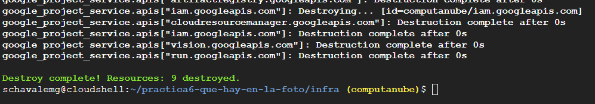

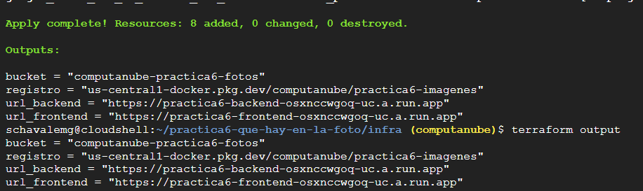

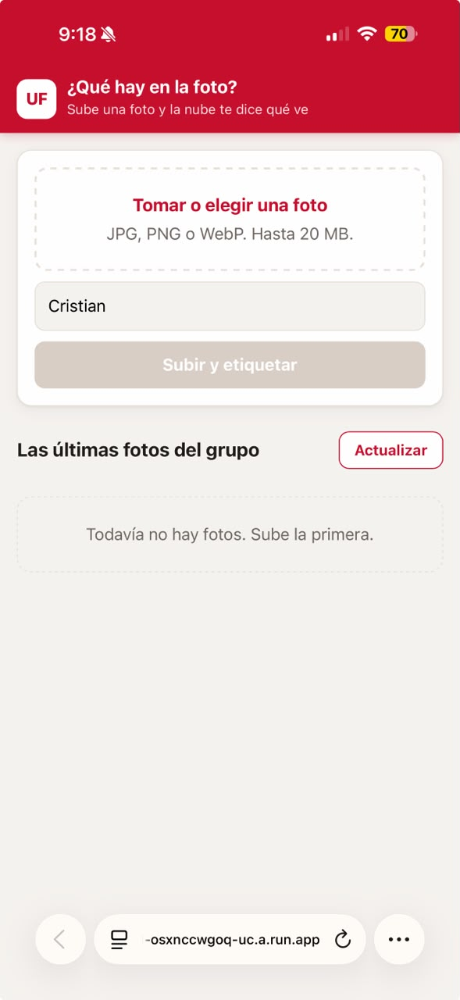


## Decisiones del reto

### Cómo mostramos el texto

El backend hace una segunda llamada a Vision, `text_detection`, sobre la misma miniatura (función `leer_texto` en `backend/main.py`). El texto leído se guarda como un metadato más de la miniatura (`texto`), el endpoint `GET /fotos` lo devuelve, y la galería lo muestra debajo de la foto como "Texto: ...", recortado a 120 caracteres.

- **Cuando Vision no encuentra texto**, se guarda una cadena vacía y la galería no muestra nada. Si la llamada falla, también se guarda vacío y el backend deja una advertencia en sus registros; la foto se guarda igual.
- **Cuánto texto cabe en un metadato**: los metadatos personalizados de un objeto suman como máximo 8 KiB. Recortamos el texto a 4.000 bytes para dejar espacio al autor y a las etiquetas.
- Cada foto gasta ahora 2 unidades de Vision en vez de 1. Para desplegar el cambio usamos imágenes nuevas, `backend:v2` y `frontend:v2`, y las cambiamos en `terraform.tfvars`.

### La edad de la regla de ciclo de vida

En `storage.tf` agregamos al bucket una `lifecycle_rule` con `condition { age = 7 }` y `action { type = "Delete" }`.

- **Por qué 7 días**: alcanza para la semana de la práctica y la revisión. Con 1 día se borrarían fotos antes de revisarlas, y con 30 se acumularía más espacio y nos acercaríamos a los 5 GB gratis.
- **Un objeto subido el día en que corre la regla** tiene edad 0, así que no se borra. Se borra cuando cumpla 7 días. Google evalúa la regla de forma asíncrona, más o menos una vez al día, y el borrado puede tardar hasta 24 horas después de cumplirse la condición.
- **Cómo comprobaríamos que funciona**: anotar el nombre de una foto de hoy, volver a listar el bucket con `gcloud storage ls gs://computanube-practica6-fotos/miniaturas/` dentro de 8 o 9 días, y verificar que ya no está.

### Qué cuota se agota primero

Vision, a las 500 fotos al mes. Los números y de dónde salen están en la evidencia de la fase 6, punto 3: tamaños reales de nuestro bucket (`gcloud storage ls -l`), la cuota gratuita de la tabla "Lo que cuesta" de la guía y el gasto por foto según el código del backend y del frontend.

### Cómo reproducimos

Con `terraform destroy` se borró todo y se volvió a crear sin pasos en la consola, en este orden:

1. `terraform apply -target=google_artifact_registry_repository.registro`: las APIs y el registro.
2. `docker build` y `docker push` de `backend:v2` y `frontend:v2`, porque el destroy borró el registro con sus imágenes.
3. `terraform apply`: las cuentas de servicio y el bucket, después el permiso del backend sobre el bucket, después el backend (necesita el nombre del bucket) y por último el frontend (necesita la URL del backend).

El bucket se volvió a crear con el mismo nombre, `computanube-practica6-fotos`, porque el nombre sale de las variables (proyecto y prefijo). Las URLs de Cloud Run también quedaron iguales. Las APIs no se apagaron con el destroy gracias a `disable_on_destroy = false`.

**Sin `force_destroy = true`**, el `terraform destroy` fallaría con un error de que el bucket no está vacío, porque Google no deja borrar un bucket que tiene objetos. Habría que vaciarlo a mano antes, y eso rompe la regla de no hacer pasos manuales.

## Preguntas

**1. ¿Por qué la foto de la fase 2 sigue sin etiquetas después de habilitar Vision, y qué tendría que cambiar en el backend para que las tuviera?**

Porque el backend le pregunta a Vision una sola vez, en el momento en que recibe la foto (`subir()` llama a `etiquetar()` antes de guardar), y el resultado queda escrito como metadato de la miniatura. Cuando subimos esa foto la API no estaba habilitada, así que se guardó con `etiquetas` vacío y `vision: error: 403...`. Habilitar Vision después no cambia nada de lo que ya está en el bucket, porque nadie vuelve a preguntar por esa foto. Para que la tuviera, el backend necesitaría una forma de volver a etiquetar: por ejemplo un endpoint como `POST /fotos/<id>/reetiquetar`, o un proceso que recorra `miniaturas/`, busque los objetos cuyo metadato `vision` no sea `ok`, descargue cada miniatura, llame a `etiquetar()` y actualice sus metadatos.

**2. Si le quitan el permiso `storage.objectUser` a la cuenta del backend, ¿qué deja de funcionar, qué ve el usuario y dónde encontrarían el error?**

Deja de funcionar todo lo que toca el bucket, porque ese rol es el único permiso que tiene la cuenta del backend: subir fotos (crear objetos), cargar la galería (listar objetos) y mostrar las miniaturas (leer objetos). El usuario ve que la subida falla con un error del servidor (500), que la galería no carga y que las imágenes no aparecen. La página y el backend siguen en línea; lo que falla es cada acceso al bucket. El error se encuentra en los registros del servicio `practica6-backend` en Cloud Run, como un `403 Forbidden` que dice que la cuenta `practica6-backend@computanube.iam.gserviceaccount.com` no tiene permiso `storage.objects.create` o `storage.objects.list` sobre el bucket.

**3. ¿Por qué el backend le manda a Vision la miniatura y no el original? Den dos razones distintas.**

Primera, el tamaño: la miniatura pesa unas 24 veces menos que el original (≈ 110 KB contra ≈ 2,6 MB en nuestro bucket), así que la petición a Vision viaja más rápido, el usuario espera menos por sus etiquetas, el backend usa menos memoria y se evita pasar el límite de tamaño de imagen que acepta Vision. Segunda, no hace falta más resolución: para reconocer qué hay en una foto basta con 1024 píxeles por lado, y Vision cobra lo mismo por unidad sin importar el tamaño de la imagen. Además, la miniatura ya viene con la orientación corregida a partir de los datos EXIF, así que Vision ve la foto derecha, como la ve el usuario.